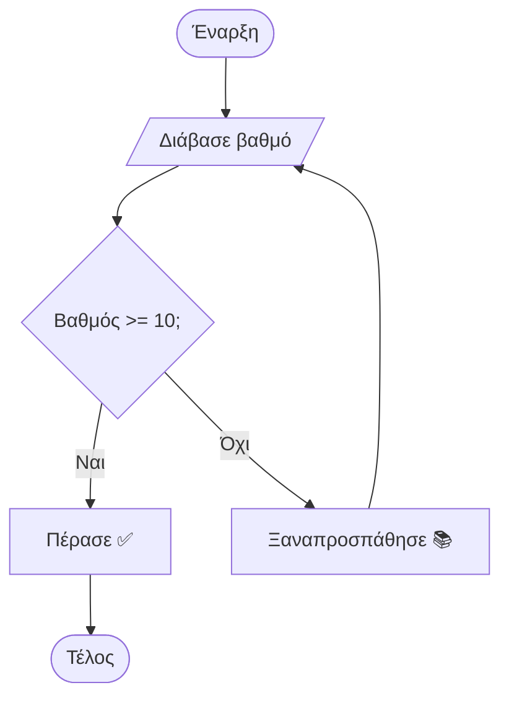
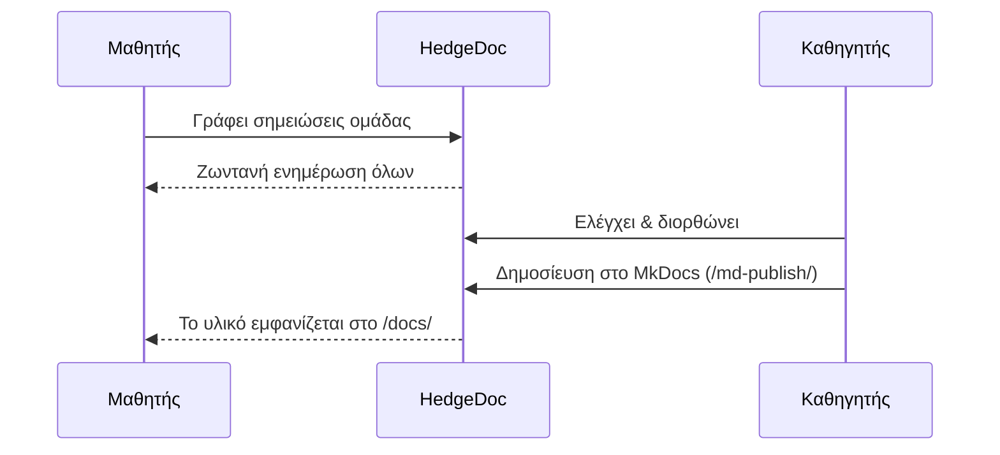
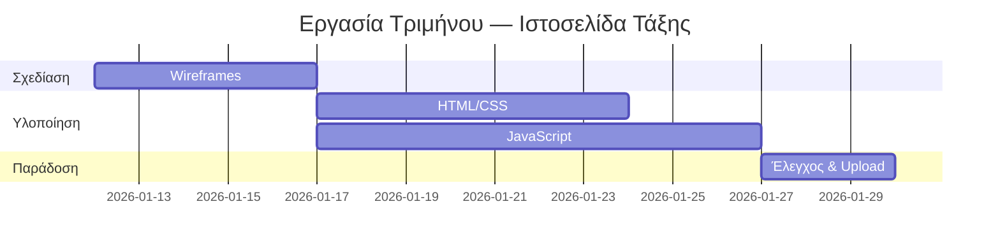
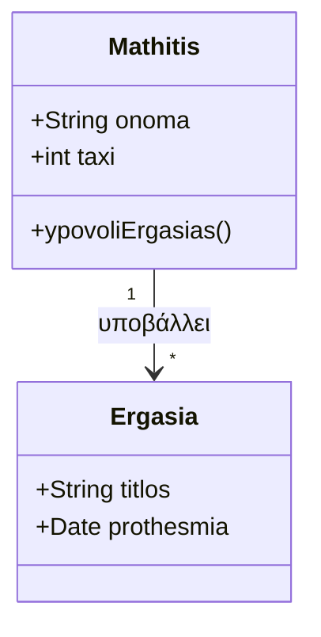
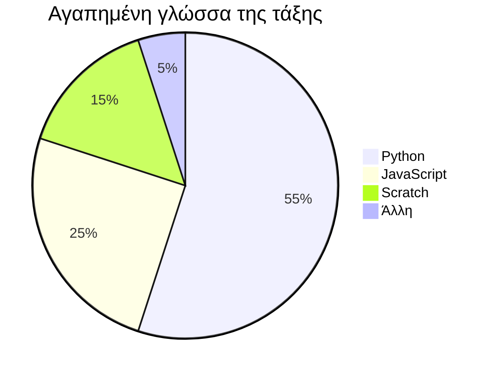

# 📋 Πρότυπο Δυνατοτήτων HedgeDoc

> **Οδηγίες χρήσης:** Αυτό το έγγραφο επιδεικνύει **όλες** τις δυνατότητες του HedgeDoc.
> Για να το χρησιμοποιήσετε ως αφετηρία: Menu (☰ πάνω δεξιά) → **Download → Markdown**, ή απλά επιλέξτε όλο το κείμενο στον editor (++ctrl+a++), αντιγράψτε το (++ctrl+c++) και επικολλήστε το σε **νέα σημείωση**. :smiley:

[TOC]

---

## 1. Τίτλοι & Δομή

Οι τίτλοι ξεκινούν με `#` (ένα ανά επίπεδο). Το αυτόματο περιεχόμενο `[TOC]` παραπάνω δημιουργείται από αυτούς:

```markdown
# Τίτλος 1 (κεφάλαιο)
## Τίτλος 2 (ενότητα)
### Τίτλος 3 (υποενότητα)
#### Τίτλος 4
##### Τίτλος 5
###### Τίτλος 6
```

Οριζόντια γραμμή διαχωρισμού με τρεις παύλες:

---

## 2. Μορφοποίηση Κειμένου

| Σύνταξη | Αποτέλεσμα |
| ------- | ---------- |
| `**έντονα**` | **έντονα** |
| `*πλάγια*` | *πλάγια* |
| `~~διαγραμμένα~~` | ~~διαγραμμένα~~ |
| `==υπογραμμισμένα==` | ==υπογραμμισμένα== |
| `++υπογράμμιση++` | ++υπογράμμιση++ |
| `` `inline κώδικας` `` | `print("γειά")` |
| `H~2~O` | H~2~O (δείκτης) |
| `x^2^` | x^2^ (εκθέτης) |
| `++ctrl+c++` | ++ctrl+c++ (πλήκτρο) |
| `:tada:` | :tada: (emoji) |

> Παράθεση (blockquote): «Η εκπαίδευση δεν είναι γέμισμα ενός κουβά, αλλά άναμμα μιας φωτιάς.»
> > Ένθετη παράθεση με δεύτερο επίπεδο.

Σύνδεσμος: [Ψηφιακή Πύλη — Εκπαιδευτικό Υλικό](/docs/) · Αυτόματος σύνδεσμος: https://hedgedoc.org

Αναφορά συντόμευσης: Διαβάστε τη [σημείωση αναφοράς][ref1].

[ref1]: https://docs.hedgedoc.org/ "Τεκμηρίωση HedgeDoc"

Συντομογραφία: Το HTML είναι γλώσσα σήμανσης.

*[HTML]: HyperText Markup Language

## 3. Λίστες

### Απλή λίστα (κουκκίδες)
- Πληροφορική Α' Γυμνασίου
  - Εισαγωγή στους υπολογιστές
  - Αλγόριθμοι στην καθημερινότητα
- Πληροφορική Β' Γυμνασίου
  - Δομές επανάληψης

### Αριθμημένη λίστα
1. Άνοιξε τον browser
2. Πήγαινε στο `/md-pad/`
3. Δημιούργησε νέα σημείωση
   1. Δώσε μοναδικό όνομα ομάδας
   2. Μοιράσου τον σύνδεσμο

### ✅ Λίστα ελέγχου (Task list)
- [x] Δημιουργία ομάδας
- [x] Ανάθεση ρόλων (συντονιστής, γραφέας, παρουσιαστής)
- [ ] Συγγραφή κοινών σημειώσεων
- [ ] Δημοσίευση στο μάθημα της τάξης

### Λίστα ορισμών
Αλγόριθμος
: Μια πεπερασμένη ακολουθία σαφών βημάτων για την επίλυση ενός προβλήματος.

Μεταβλητή
: Ένα όνομα που αντιστοιχεί σε θέση μνήμης με μεταβαλλόμενη τιμή.

## 4. Πίνακες

| Τάξη | Ενότητα | Εβδομάδες | Διδάσκων |
|:-----|:-------:|----------:|:---------|
| Α' Γυμνασίου | Εισαγωγή | 4 | κ. Παπαδόπουλος |
| Β' Γυμνασίου | Επαναλήψεις | 6 | κα. Ιωάννου |
| Γ' Λυκείου | Πανελλαδικές | 12 | κ. Νικολάου |

Οι τελείες στη γραμμή κεφαλίδας ορίζουν στοίχιση: `:---` αριστερά, `:---:` κέντρο, `---:` δεξιά.

## 5. Πλαίσια Επισήμανσης (Containers)

:::info
ℹ️ **Πληροφορία:** Οι σημειώσεις αποθηκεύονται αυτόματα σε κάθε αλλαγή — δεν χρειάζεται χειροκίνητη αποθήκευση. Χρησιμοποιήστε αυτό το πλαίσιο για χρήσιμες πληροφορίες.
:::

:::success
✅ **Επιτυχία:** Η εργασία της ομάδας ολοκληρώθηκε και δημοσιεύτηκε στο μάθημα! Χρησιμοποιήστε το για θετικά αποτελέσματα.
:::

:::warning
⚠️ **Προσοχή:** Μην μοιράζεστε προσωπικά δεδομένα (τηλέφωνα, διευθύνσεις) στις συνεργατικές σημειώσεις. Χρησιμοποιήστε το για επισημάνσεις.
:::

:::danger
🛑 **Κίνδυνος:** Η διαγραφή περιεχομένου επηρεάζει ΟΛΟΥΣ τους συνεργάτες ζωντανά! Χρησιμοποιήστε το για κρίσιμες προειδοποιήσεις.
:::

## 6. Υποσημειώσεις

Η Python δημιουργήθηκε από τον Guido van Rossum[^1] το 1991. Είναι σήμερα η πιο δημοφιλής γλώσσα για αρχάριους[^2].

[^1]: Ο Guido van Rossum εργάστηκε στο CWI της Ολλανδίας.
[^2]: Σύμφωνα με τις έρευνες Stack Overflow των τελευταίων ετών.

## 7. Μαθηματικά (LaTeX / MathJax)

Inline εξίσωση μέσα σε πρόταση: η ενέργεια δίνεται από $E = mc^2$, ενώ η ταυτότητα του Euler είναι $e^{i\pi} + 1 = 0$.

Εξίσωση σε δική της γραμμή (display):

$$
x = \frac{-b \pm \sqrt{b^2 - 4ac}}{2a}
$$

Κλάσματα, ρίζες, αθροίσματα και ολοκληρώματα:

$$
\frac{\partial f}{\partial x} = \lim_{h \to 0} \frac{f(x+h) - f(x)}{h}
\qquad
\sqrt[n]{x^n} = |x|
\qquad
\sum_{i=1}^{n} i = \frac{n(n+1)}{2}
\qquad
\int_0^\infty e^{-x}\,dx = 1
$$

Πίνακας LaTeX και σύστημα:

$$
A = \begin{pmatrix} 1 & 2 \\ 3 & 4 \end{pmatrix}
\qquad
\begin{cases} 2x + y = 5 \\ x - y = 1 \end{cases}
$$

## 8. Μπλοκ Κώδικα με Χρωματισμό Σύνταξης

### Python
```python
def fibonacci(n: int) -> list[int]:
    """Επιστρέφει τους πρώτους n αριθμούς Fibonacci."""
    akm = [0, 1]
    for i in range(2, n):
        akm.append(akm[-1] + akm[-2])
    return akm[:n]

print(fibonacci(10))  # [0, 1, 1, 2, 3, 5, 8, 13, 21, 34]
```

### JavaScript
```javascript
const mathites = ['Άννα', 'Γιώργος', 'Ελένη'];
const present = mathites.filter(m => m.length > 4);
console.log(`Παρώντες: ${present.join(', ')}`);
```

### HTML
```html
<!DOCTYPE html>
<html lang="el">
<head><meta charset="utf-8"><title>Η σελίδα μου</title></head>
<body>
  <h1>Γεια σου κόσμε!</h1>
  <p>Η πρώτη μου ιστοσελίδα.</p>
</body>
</html>
```

### SQL
```sql
SELECT t.onoma, AVG(b.vathmos) AS mesos_oros
FROM mathites t
JOIN vathmoi b ON b.mathitis_id = t.id
GROUP BY t.onoma
HAVING AVG(b.vathmos) >= 15
ORDER BY mesos_oros DESC;
```

### Bash & Diff
```bash
#!/bin/bash
for f in *.md; do
  echo "Μετατροπή: $f"
done
```

```diff
- palia_grammi = 10
+ nea_grammi = 20
```

## 9. Διαγράμματα

### Mermaid — Διάγραμμα Ροής


### Mermaid — Διάγραμμα Ακολουθίας


### Mermaid — Gantt (χρονοδιάγραμμα εργασίας)


### Mermaid — Διάγραμμα Κλάσεων & Pie




### UML Διάγραμμα Ακολουθίας (js-sequence)
```sequence
Μαθητής->HedgeDoc: Άνοιγμα /md-pad/omada-3
Note right of HedgeDoc: Ζωντανός συγχρονισμός
HedgeDoc-->Μαθητής: Κοινό έγγραφο ✏️
```

### Διάγραμμα Ροής (flowchart.js)
```flow
st=>start: Έναρξη
op=>operation: Διάβασε δύο αριθμούς
cond=>condition: Είναι ίσοι;
e=>end: Τέλος
io=>inputoutput: Εμφάνισε αποτέλεσμα

st->op->cond
cond(yes)->io->e
cond(no)->op
```

## 10. Εικόνες, Βίντεο & Πολυμέσα

### Εικόνα με καθορισμένο μέγεθος


### QR Code (σκανάρετε με κινητό για είσοδο στο πρότυπο!)


### Ενσωμάτωση YouTube (πατήστε την εικόνα για αναπαραγωγή)


### Τοπικό βίντεο HTML5 (ανεβάστε .mp4 στα Κοινόχρηστα Αρχεία /share/)
<video controls width="480" src="/share/videos/demo.mp4">Ο browser σας δεν υποστηρίζει βίντεο.</video>

### Ενσωμάτωση PDF


## 11. Αναδιπλούμενες Ενότητες (Spoilers)

<details>
<summary>💡 Κάντε κλικ για τη λύση της άσκησης</summary>

Η άσκηση ζητούσε το άθροισμα $1 + 2 + \dots + 100$. Με τον τύπο του Gauss:

$$
S = \frac{n(n+1)}{2} = \frac{100 \cdot 101}{2} = 5050
$$

```python
print(sum(range(1, 101)))  # 5050
```
</details>

<details>
<summary>📎 Επιπλέον υλικό για προχωρημένους</summary>

- [Τεκμηρίωση Python](https://docs.python.org/3/)
- [Markdown οδηγός](https://www.markdownguide.org/)
- Μέσα σε spoiler λειτουργούν **όλα**: λίστες, κώδικας, μαθηματικά $\alpha^2+\beta^2=\gamma^2$.
</details>

## 12. Προχωρημένα

### YAML Metadata (κεφαλίδα εγγράφου)
Στην κορυφή αυτού του εγγράφου υπάρχει μπλοκ `---` με `title`, `lang: el`, `tags` κ.λπ. Δείτε Menu → **YAML metadata** για επιλογές όπως `slideOptions`, `breaks`, `mathjax`.

### Παρουσίαση (Slides)
Κάθε σημείωση γίνεται παρουσίαση με το κουμπί **Slide** (Menu → Slide)! Διαχωρίστε διαφάνειες με `---`. Δοκιμάστε το τώρα σε αυτή τη σημείωση. :movie_camera:

### Ιστορικό & Αναθεωρήσεις
Menu → **Revisions**: δείτε κάθε παλαιότερη έκδοση και επαναφέρετε την αν χρειαστεί.

### Δημοσίευση στο MkDocs
Ο καθηγητής μπορεί από το [/md-publish/](/md-publish/) να ενσωματώσει αυτή τη σημείωση σε υπάρχον μάθημα ή να δημιουργήσει νέο — με αυτόματο backup και μετατροπή των `:::info` πλαισίων σε Material admonitions!

---

*Πρότυπο Τμήματος Πληροφορικής — Ψηφιακή Πύλη Σχολείου & Εργαστηρίου* :school:
