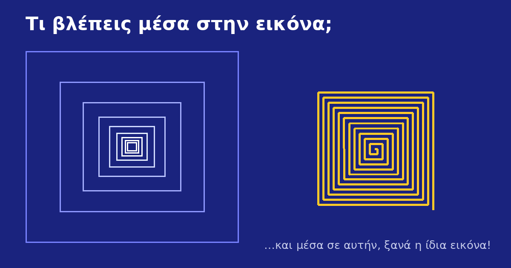

# 🌀 Μ01 · Αναδρομή: Αυτοομοιότητα & Σπιράλ

📖 **Βιβλίο:** Ενότητα 1 «Αλγοριθμική», §1.1–1.2, σελ. 7–8 —
[Άνοιγμα στο βιβλίο (PDF)](https://eclass.sch.gr/modules/document/file.php/0740110278/GYMNASIO-plhroforiki/21-0227-01_V2_Pliroforiki_G-Gymnasiou_Vivlio-Mathiti.pdf){target=_blank} ·
[Οι σελίδες του μαθήματος](vivlio-sel-7-8.pdf){target=_blank}


<!-- /phase -->

<!-- phase: aformisi | title: Αφόρμηση — Εικόνες μέσα σε εικόνες | duration: 5 -->
## 🎯 Ας ξεκινήσουμε!



Φωτογράφισε με το κινητό σου έναν μεγάλο καθρέπτη, έτσι ώστε να φαίνεται το κινητό μέσα στη φωτογραφία.
Μέσα στο κινητό φαίνεται ο καθρέπτης… και μέσα στον καθρέπτη ξανά το κινητό! **Η ίδια εικόνα επαναλαμβάνεται
μέσα στον εαυτό της.** Αυτό ακριβώς θα μελετήσουμε σήμερα: την **αναδρομή**.
<!-- /phase -->

<!-- phase: syzitisi | title: Μικρή Συζήτηση | duration: 7 -->
## 💬 Η γνώμη σας μετράει

!!! question "Συζητάμε σε ζευγάρια και μετά στην τάξη"
    1. Πού αλλού έχεις δει **εικόνες που περιέχουν τον εαυτό τους**; (Σκέψου: κουτί κακάο με ετικέτα τον εαυτό του, δύο καθρέπτες αντικριστά, μπρόκολο…)
    2. Αν έλεγες σε έναν φίλο «*για να φτιάξεις αυτό το σχήμα, φτιάξε πρώτα το ίδιο σχήμα λίγο μικρότερο*» — θα τον μπέρδευες ή θα τον βοηθούσε;
    3. Τι θα χρειαζόταν ώστε αυτή η διαδικασία να **σταματήσει** κάποια στιγμή;

Γράψε τη σκέψη σου στο [συνεργατικό σημειωματάριο της τάξης](/md-pad/){target=_blank} ή μοιράσου την προφορικά.
<!-- /phase -->

<!-- phase: parousiasi | title: Παρουσίαση — Τι είναι η αναδρομή | duration: 10 -->
## 📽️ Τι είναι η αναδρομή;

Παρακολούθησε την παρουσίαση (και με το κουμπί **🖥️ Παρουσίαση** πάνω-πάνω για προβολή στην τάξη):

<object data="slides.pdf" type="application/pdf" width="100%" height="480px">
<p>📄 <a href="slides.pdf" target="_blank">Άνοιγμα της παρουσίασης (PDF)</a></p>
</object>

**Το κλειδί:** ένας *αναδρομικός* ορισμός αναφέρεται **στον εαυτό του**. Ο αλγόριθμος του σπιράλ από το βιβλίο:

```glossa
ΟΡΙΣΜΟΣ Σχεδίασε_Σπιράλ(βήματα)
  Προχώρα βήματα
  Στρίψε αριστερά 90°
  Σχεδίασε_Σπιράλ(βήματα + 5)
```

Κάθε πλευρά είναι 5 βήματα μακρύτερη από την προηγούμενη — και η εντολή **καλεί τον εαυτό της**!
<!-- /phase -->

<!-- phase: drastiriotita | title: Δραστηριότητα — Το σπιράλ ζωντανεύει | duration: 15 -->
## ✍️ Δραστηριότητα: Πείραμα με το σπιράλ

### Βήμα 1 — Χωρίς συνθήκη διακοπής (όπως προτείνει το ΙΕΠ!)

Άνοιξε το διαδραστικό παρακάτω, **χωρίς** να τσεκάρεις τη «Συνθήκη διακοπής», και πάτησε **▶ Ξεκίνα**.
Παρατήρησε τις κλήσεις `spiral(10) → spiral(15) → spiral(20) → …` Τι συμβαίνει; Γιατί;

<iframe src="spiral.html" width="100%" height="640" style="border:1px solid #c5cae9;border-radius:8px;" loading="lazy" title="Διαδραστικό σπιράλ"></iframe>

### Βήμα 2 — Με συνθήκη διακοπής

Τσέκαρε τώρα τη **«Συνθήκη διακοπής (μήκος < 360)»** και ξανατρέξε το. Πόσες κλήσεις έγιναν πριν σταματήσει;

### Βήμα 3 — Γράψε τον δικό σου κώδικα (ατομικά)

Συμπλήρωσε τη συνθήκη ώστε το σπιράλ να σταματά στα 360 βήματα και εκτέλεσέ το με ▶:

```python
def spiral(mikos, vimata=None):
    if vimata is None:
        vimata = []
    vimata.append(mikos)
    if ____________________:        # ← ΒΗΜΑ ΔΙΑΚΟΠΗΣ: συμπλήρωσε!
        spiral(mikos + 5, vimata)
    return vimata

plevres = spiral(10)
print("Πλευρές:", plevres)
print("Πλήθος πλευρών:", len(plevres))
```

??? tip "Χρειάζεσαι βοήθεια;"
    Η αναδρομική κλήση πρέπει να γίνεται **μόνο αν** `mikos < 360`. Δοκίμασε: `if mikos < 360:`

**Παραδοτέο:** Αντέγραψε τον κώδικά σου και το πλήθος πλευρών που τύπωσε, και υπόβαλέ τα στο
[📤 Σύστημα Παράδοσης Εργασιών](/exams/){target=_blank} με τίτλο **«Μ01 — Σπιράλ»** (ή στο τετράδιό σου αν δουλεύουμε offline).
<!-- /phase -->

<!-- phase: aksiologisi | title: Διαμορφωτική Αξιολόγηση | duration: 6 -->
## ✅ Έλεγξε τι έμαθες

<div class="quiz" data-quiz='[
 {"q":"Τι ονομάζουμε αναδρομικό ορισμό;","options":["Έναν ορισμό που επαναλαμβάνεται πολλές φορές","Έναν ορισμό που αναφέρεται στον εαυτό του","Έναν ορισμό που δεν τελειώνει ποτέ","Έναν ορισμό με πολλές μεταβλητές"],"answer":1,"explain":"Αναδρομικός = αυτοαναφορικός: η λύση χρησιμοποιεί τον εαυτό της σε μικρότερο στιγμιότυπο."},
 {"q":"Το σπιράλ χωρίς συνθήκη διακοπής παραβιάζει ποια ιδιότητα του αλγορίθμου;","options":["Την καθοριστικότητα","Την έξοδο","Την περατότητα","Την είσοδο"],"answer":2,"explain":"Περατότητα: κάθε αλγόριθμος πρέπει να τελειώνει μετά από πεπερασμένα βήματα."},
 {"q":"Στο spiral(10) με βήμα +5, ποια είναι η 4η κλήση;","options":["spiral(20)","spiral(25)","spiral(30)","spiral(15)"],"answer":1,"explain":"10 → 15 → 20 → 25: η 4η κλήση είναι η spiral(25)."},
 {"q":"Γιατί επιλέχθηκε το όριο των 360 βημάτων στο παράδειγμα του βιβλίου;","options":["Είναι τυχαίος αριθμός","Είναι το μέγιστο μήκος της σκηνής στον κατακόρυφο άξονα","Επειδή 360 = οι μοίρες του κύκλου","Επειδή η Python σταματά εκεί"],"answer":1,"explain":"Λογική τιμή: το ύψος της σκηνής (360 βήματα) — πέρα από αυτό το σχέδιο βγαίνει εκτός οθόνης."},
 {"q":"Ποιο από τα παρακάτω είναι παράδειγμα αυτοομοιότητας;","options":["Ένα τετράγωνο","Το τρίγωνο Sierpinski","Ένας κύκλος","Μια ευθεία γραμμή"],"answer":1,"explain":"Το fractal Sierpinski περιέχει μικρότερα αντίγραφα του εαυτού του — θα το δούμε στο Μ03!"}
]'></div>
<!-- /phase -->

<!-- phase: kleisimo | title: Κλείσιμο & Αναστοχασμός | duration: 2 -->
## 🧭 Τι κρατάμε σήμερα

- **Αναδρομή** = όταν κάτι ορίζεται ή λύνεται **με τον εαυτό του**, σε μικρότερη κλίμακα.
- Κάθε αναδρομή χρειάζεται **βήμα διακοπής** — αλλιώς δεν τελειώνει ποτέ!
- Την είδαμε σε εικόνες (Droste, fractals) και σε αλγόριθμο (σπιράλ).

➡️ **Επόμενο μάθημα:** [Μ02 · Οι Πύργοι του Ανόι](../m02-pyrgoi-anoy/index.md) — η αναδρομή ως *τεχνική επίλυσης προβλημάτων*.
<!-- /phase -->

<!-- teacher-notes -->
**Διδακτικοί στόχοι (ΙΕΠ, Ε1):** αναγνώριση αναδρομικής δομής σε πρόβλημα/αντικείμενο · εκτέλεση απλών
αναδρομικών αλγορίθμων · αναγνώριση της αναγκαιότητας του βήματος διακοπής.

**Ροή & χρόνοι (45΄):** αφόρμηση 5΄ → συζήτηση 7΄ → παρουσίαση 10΄ → δραστηριότητα 15΄ → κουίζ 6΄ → κλείσιμο 2΄.

**Σημείωση ΙΕΠ:** Η αναδρομή παρουσιάζεται ΠΡΩΤΑ οπτικά (αυτοομοιότητα), μετά αλγοριθμικά. Στο σπιράλ,
οι μαθητές δοκιμάζουν πρώτα την εκδοχή χωρίς συνθήκη διακοπής ώστε να ανακαλύψουν μόνοι τους την αναγκαιότητά της —
μην δώσετε τη λύση πρόωρα!

**Αναμενόμενες δυσκολίες:** σύγχυση αναδρομής ↔ επανάληψης («είναι σαν for;»). Τονίστε: στην επανάληψη
επαναλαμβάνεται *εντολή*, στην αναδρομή *ο ίδιος ο ορισμός* καλεί τον εαυτό του με διαφορετική είσοδο.

**Λύση Βήματος 3:** `if mikos < 360:` — τυπώνει 71 πλευρές (10, 15, …, 360). Αν κάποιος βάλει `< 355`
παίρνει 70 — συζητήστε το off-by-one, είναι φυσικό λάθος και καλή ευκαιρία.

**Διαφοροποίηση:** για προχωρημένους — αλλαγή γωνίας στροφής σε 60° ή 120° (επέκταση στο σπίτι).
Για αδύναμους — δουλέψτε το Βήμα 1 μόνο προφορικά, με καταμέτρηση κλήσεων στον πίνακα.

**Υλικό φακέλου:** `aformisi.png` (αφόρμηση), `slides.pdf` (6 διαφάνειες), `spiral.html` (διαδραστικό),
`vivlio-sel-7-8.pdf` (απόσπασμα βιβλίου). Όλα τοπικά — λειτουργεί και χωρίς Internet.
<!-- /teacher-notes -->
