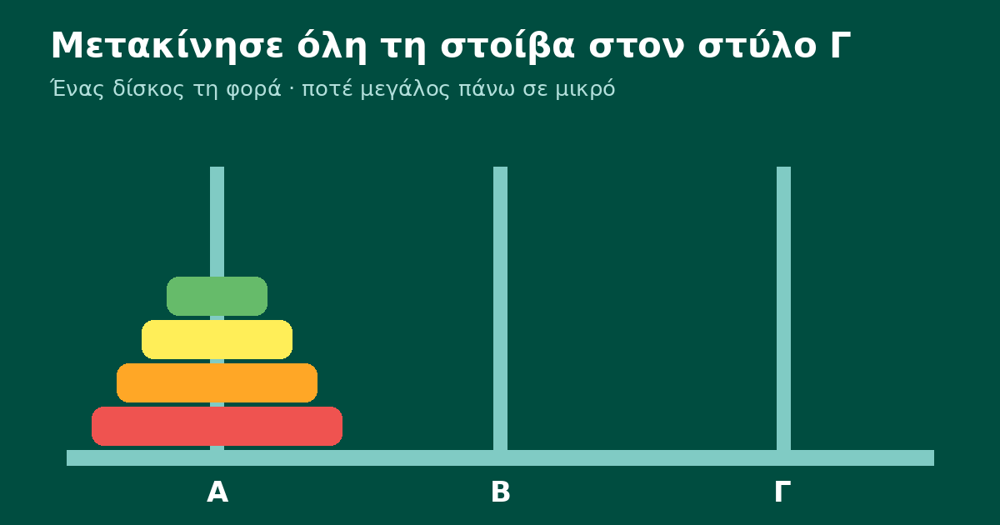

# 🗼 Μ02 · Οι Πύργοι του Ανόι

📖 **Βιβλίο:** Ενότητα 1 «Αλγοριθμική», Δραστηριότητα 1, σελ. 9 —
[Άνοιγμα στο βιβλίο (PDF)](https://eclass.sch.gr/modules/document/file.php/0740110278/GYMNASIO-plhroforiki/21-0227-01_V2_Pliroforiki_G-Gymnasiou_Vivlio-Mathiti.pdf){target=_blank} ·
[Η σελίδα του μαθήματος](vivlio-sel-9.pdf){target=_blank}

<!-- phase: aformisi | title: Αφόρμηση — Ο θρύλος των τριών στύλων | duration: 5 -->
## 🎯 Ο θρύλος του Ανόι



Σε έναν ναό στο Ανόι, λέει ο θρύλος, οι μοναχοί μετακινούν **64 χρυσούς δίσκους** ανάμεσα σε τρεις στύλους:
έναν δίσκο τη φορά, και ποτέ μεγάλος πάνω σε μικρότερο. Όταν τελειώσουν… θα τελειώσει ο κόσμος!
Σήμερα θα λύσουμε το ίδιο πρόβλημα — ξεκινώντας από **3 δίσκους**. Θα προλάβουμε; 😄
<!-- /phase -->

<!-- phase: syzitisi | title: Μικρή Συζήτηση — Στρατηγική | duration: 6 -->
## 💬 Πριν παίξουμε, ας σκεφτούμε

!!! question "Συζητάμε σε ομάδες των 3"
    1. Με **1 δίσκο**: πόσες κινήσεις χρειάζονται; Με **2 δίσκους**; Δοκιμάστε νοερά!
    2. Για να πάει ο **μεγαλύτερος** δίσκος από τον Α στον Γ, τι πρέπει πρώτα να γίνει με τους άλλους;
    3. Ποιος στύλος θα μας «βοηθήσει»; Μπορούμε να λύσουμε το πρόβλημα χωρίς βοηθητικό στύλο;

Καταγράψτε τις προβλέψεις σας (κινήσεις για 3 δίσκους) στο [σημειωματάριο της τάξης](/md-pad/){target=_blank} — θα τις ελέγξουμε μετά!
<!-- /phase -->

<!-- phase: parousiasi | title: Παρουσίαση — Αναγωγή σε απλούστερο πρόβλημα | duration: 10 -->
## 📽️ Η «έξυπνη» ιδέα της αναδρομής

<object data="slides.pdf" type="application/pdf" width="100%" height="480px">
<p>📄 <a href="slides.pdf" target="_blank">Άνοιγμα της παρουσίασης (PDF)</a></p>
</object>

Η λύση για 3 δίσκους **χρησιμοποιεί τη λύση για 2** — αυτό λέγεται *αναγωγή σε απλούστερο στιγμιότυπο του ίδιου προβλήματος*:

```glossa
ΟΡΙΣΜΟΣ Μετακίνησε_3_δίσκους(Α, Γ)
  Μετακίνησε_2_δίσκους(Α, Β)   // οι 2 μικροί στον βοηθητικό
  Μετακίνησε(Α, Γ)             // ο μεγαλύτερος στον στόχο
  Μετακίνησε_2_δίσκους(Β, Γ)   // οι 2 μικροί πάνω του
```
<!-- /phase -->

<!-- phase: drastiriotita | title: Δραστηριότητα — Παίζουμε & γράφουμε αλγόριθμο | duration: 17 -->
## ✍️ Δραστηριότητα: Τα 4 βήματα του βιβλίου

### Βήμα 1 — Λύσε το με 3 δίσκους (ομαδικά, σε ζευγάρια)

Παίξε στο διαδραστικό παρακάτω. **Κλικ** στον στύλο-αφετηρία και μετά στον στύλο-προορισμό.
Προσπάθησε να το λύσεις με τις **ελάχιστες** κινήσεις!

<iframe src="anoy.html" width="100%" height="560" style="border:1px solid #b2dfdb;border-radius:8px;" loading="lazy" title="Παιχνίδι Πύργοι του Ανόι"></iframe>

### Βήμα 2 — Γράψε τον αλγόριθμο (ψευδογλώσσα)

Στο τετράδιό σου, γράψε τη ακολουθία `Μετακίνησε(αρχή, προορισμός)` που έκανες — πρέπει να είναι **7 κινήσεις**.
Έπειτα συμπλήρωσε τον «έξυπνο» αναδρομικό ορισμό για 3 δίσκους (δες την παρουσίαση).

### Βήμα 3 — Από τους 3 στους 4 και 5 δίσκους

Άλλαξε το παιχνίδι στους **4 δίσκους**. Αν είχες διαθέσιμη την εντολή `Μετακίνησε_3_δίσκους(Χ, Υ)`,
τι θα άλλαζε στη λύση σου; Γράψε τον `Μετακίνησε_4_δίσκους(Α, Γ)` με **3 μόνο γραμμές**!

??? tip "Κλιμάκωση (αν δυσκολεύεσαι)"
    Σκέψου: «μετακίνησε τους 3 πάνω στον βοηθητικό → ο μεγαλύτερος στον στόχο → οι 3 από τον βοηθητικό στον στόχο».
    Το ίδιο μοτίβο δουλεύει για 5, 6, … Ν δίσκους!

### Βήμα 4 — Το μοτίβο των κινήσεων 🔍

Συμπλήρωσε τον πίνακα παίζοντας (ή σκεπτόμενος):

| Δίσκοι (Ν) | 1 | 2 | 3 | 4 | 5 |
| --- | --- | --- | --- | --- | --- |
| Ελάχιστες κινήσεις | 1 | 3 | ; | ; | ; |

Βρες τον κανόνα: κάθε φορά οι κινήσεις **διπλασιάζονται και προστίθεται 1**. Άρα Κ(Ν) = 2^Ν − 1.
Επαλήθευσέ τον με Python (πάτησε ▶):

```python
def kiniseis(n):
    if n == 1:              # βήμα διακοπής
        return 1
    return 2 * kiniseis(n - 1) + 1

for n in range(1, 7):
    print(n, "δίσκοι →", kiniseis(n), "κινήσεις")

print("64 δίσκοι →", kiniseis(64), "κινήσεις!")
# Ο θρύλος: με 1 κίνηση/δευτερόλεπτο πόσα χρόνια θέλουν;
print("Χρόνια:", round(kiniseis(64) / (60*60*24*365)))
```

**Παραδοτέο (ομαδικό):** Φωτογραφία/αρχείο με τον πίνακα, τον αλγόριθμο 4 δίσκων και τα χρόνια του θρύλου →
[📤 Παράδοση Εργασιών](/exams/){target=_blank} με τίτλο **«Μ02 — Ανόι»** (ο ένας της ομάδας υποβάλλει για όλους, γράφοντας τα ονόματα).
<!-- /phase -->

<!-- phase: aksiologisi | title: Διαμορφωτική Αξιολόγηση | duration: 5 -->
## ✅ Έλεγξε τι έμαθες

<div class="quiz" data-quiz='[
 {"q":"Πόσες ελάχιστες κινήσεις χρειάζονται 3 δίσκοι;","options":["6","7","8","9"],"answer":1,"explain":"2³ − 1 = 7. Το μοτίβο: 1, 3, 7, 15, 31…"},
 {"q":"Στον αναδρομικό αλγόριθμο του Ανόι, ποιο είναι το βήμα διακοπής;","options":["Όταν αδειάσει ο στύλος Β","Όταν Ν = 1 (ένας δίσκος)","Όταν γεμίσει ο στύλος Α","Δεν υπάρχει βήμα διακοπής"],"answer":1,"explain":"Με 1 δίσκο η λύση είναι τετριμμένη: Μετακίνησε(Χ, Υ) — εκεί σταματά η αναδρομή."},
 {"q":"Για να λύσουμε το πρόβλημα των 4 δίσκων χρησιμοποιούμε…","options":["τη λύση των 2 δίσκων","τη λύση των 3 δίσκων","έναν 4ο στύλο","τύχη!"],"answer":1,"explain":"Αναγωγή: 4 → 3 → 2 → 1. Κάθε πρόβλημα ανάγεται στο ίδιο με έναν δίσκο λιγότερο."},
 {"q":"Ο τύπος των ελάχιστων κινήσεων για Ν δίσκους είναι:","options":["Ν²","2×Ν","2^Ν − 1","Ν! (παραγοντικό)"],"answer":2,"explain":"Κ(Ν) = 2·Κ(Ν−1)+1 = 2^Ν − 1. Για 64 δίσκους ≈ 1,8×10¹⁹ κινήσεις!"},
 {"q":"Γιατί ΔΕΝ βάζουμε ποτέ μεγάλο δίσκο πάνω σε μικρότερο;","options":["Είναι κανόνας του προβλήματος","Θα πέσουν οι δίσκοι","Ο υπολογιστής δεν μπορεί","Είναι απλώς σύσταση"],"answer":0,"explain":"Είναι περιορισμός του προβλήματος — αυτός ακριβώς κάνει το πρόβλημα ενδιαφέρον και μη τετριμμένο."}
]'></div>
<!-- /phase -->

<!-- phase: kleisimo | title: Κλείσιμο & Αναστοχασμός | duration: 2 -->
## 🧭 Τι κρατάμε σήμερα

- Η αναδρομή δεν είναι μόνο «εικόνες μέσα σε εικόνες» — είναι **τεχνική επίλυσης προβλημάτων**:
  λύνω το μεγάλο πρόβλημα **ανάγοντάς το** στο ίδιο, λίγο μικρότερο.
- Το μοτίβο των κινήσεων: **διπλασιασμός + 1** → 2^Ν − 1 (εκθετική αύξηση!).
- Ο θρύλος των 64 δίσκων θέλει ≈ **585 δισεκατομμύρια χρόνια** — ο κόσμος είναι ασφαλής! 😅

➡️ **Επόμενο μάθημα:** [Μ03 · Το Τρίγωνο Sierpinski](../m03-trigono-sierpinski/index.md) — αναδρομή με *τρεις* κλήσεις ανά βήμα.
<!-- /phase -->

<!-- teacher-notes -->
**Διδακτικοί στόχοι (ΙΕΠ, Ε1):** εκτέλεση & υλοποίηση απλών αναδρομικών αλγορίθμων · αναγνώριση αναγωγής
(4 δίσκοι → 3 δίσκοι) · διάκριση του μοτίβου 2^Ν−1 και σύνδεση με τις δυνάμεις του 2 (Β' Γυμνασίου, ψηφιακός κόσμος).

**Ροή & χρόνοι (45΄):** αφόρμηση 5΄ → συζήτηση 6΄ → παρουσίαση 10΄ → δραστηριότητα 17΄ → κουίζ 5΄ → κλείσιμο 2΄.

**Σημείωση ΙΕΠ:** Το Βήμα 3 (4 δίσκοι) είναι το κρίσιμο σημείο — οι μαθητές πιθανόν να δυσκολευτούν και να
χρειαστούν καθοδήγηση. Παρουσιάστε το ως εξής: «τώρα έχουμε μια ΕΝΤΟΛΗ που μετακινεί 3 δίσκους· φτιάξτε με αυτήν
την εντολή για 4». Μην δώσετε έτοιμες τις 7 κινήσεις των 3 δίσκων — αφήστε τα ζευγάρια να τις βρουν παίζοντας.

**Λύσεις:** 3 δίσκοι (Α→Γ μέσω Β): Α→Γ, Α→Β, Γ→Β, Α→Γ, Β→Α, Β→Γ, Α→Γ (7 κινήσεις).
4 δίσκοι: Μετακίνησε_3(Α,Β) · Μετακίνησε(Α,Γ) · Μετακίνησε_3(Β,Γ) = 15 κινήσεις.
kiniseis(64) = 18446744073709551615 ≈ 584,9 δισ. χρόνια με 1 κίνηση/δευτ.

**Αναμενόμενες δυσκολίες:** (α) σύγχυση «ποιος είναι ο βοηθητικός» — τονίστε ότι αλλάζει ρόλο σε κάθε αναδρομική
κλήση· (β) η Python `kiniseis` μπορεί να μοιάζει «μαγική» — συνδέστε τη ρητά με τον πίνακα που συμπλήρωσαν.

**Εναλλακτική χωρίς υπολογιστές (CS unplugged):** 3 στοίβες βιβλίων διαφορετικού μεγέθους στο θρανίο —
ίδιοι κανόνες. Χρήσιμη αν πέσει το δίκτυο ή για διαφοροποίηση.

**Σύνδεση με επόμενο:** Στο Μ03 η αναδρομή κάνει ΤΡΕΙΣ κλήσεις ανά βήμα (3^Ν τρίγωνα) — θα συγκρίνετε
τα μοτίβα 2^Ν−1 vs 3^Ν.

**Υλικό φακέλου:** `aformisi.png`, `slides.pdf` (6 διαφάνειες), `anoy.html` (παιχνίδι με μετρητή κινήσεων),
`vivlio-sel-9.pdf`. Προαιρετικά online (αν υπάρχει Internet): GeoGebra προσομοίωση https://www.geogebra.org/m/nd9fTdHh
(προτείνεται από το ΙΕΠ — ελέγξτε τη διαθεσιμότητά της πριν την τάξη).
<!-- /teacher-notes -->
