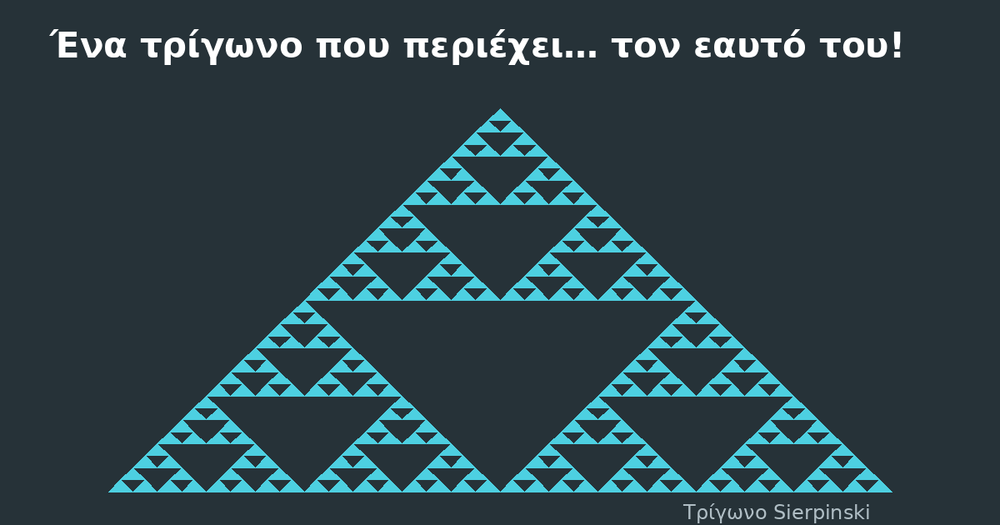

# 🔺 Μ03 · Το Τρίγωνο Sierpinski

📖 **Βιβλίο:** Ενότητα 1 «Αλγοριθμική», Δραστηριότητα 2, σελ. 10 —
[Άνοιγμα στο βιβλίο (PDF)](https://eclass.sch.gr/modules/document/file.php/0740110278/GYMNASIO-plhroforiki/21-0227-01_V2_Pliroforiki_G-Gymnasiou_Vivlio-Mathiti.pdf){target=_blank} ·
[Η σελίδα του μαθήματος](vivlio-sel-10.pdf){target=_blank}

<!-- phase: aformisi | title: Αφόρμηση — Ένα τρίγωνο-παζλ | duration: 5 -->
## 🎯 Το τρίγωνο που κρύβει… τρίγωνα!



Κοίτα προσεκτικά το σχήμα: κάθε γωνιά του είναι **ένα μικρότερο αντίγραφο ολόκληρου του σχήματος**!
Είναι το **τρίγωνο Sierpinski**, ένα *fractal*: σχήμα με αυτοομοιότητα. Θα το κατασκευάσουμε με τον πιο
απλό τρόπο — **χαρτί και μολύβι** — και θα ανακαλύψουμε πότε σταματά η αναδρομή.

<!-- /phase -->

<!-- phase: syzitisi | title: Μικρή Συζήτηση | duration: 6 -->
## 💬 Πριν ζωγραφίσουμε

!!! question "Σκέψου & συζήτησε με τον διπλανό σου"
    1. Αν σε κάθε βήμα κάθε μαύρο τρίγωνο γίνεται **3 μικρότερα**, πόσα θα έχουμε μετά από 3 βήματα;
    2. Ο αλγόριθμος λέει «εφάρμοσε τον ίδιο αλγόριθμο σε κάθε τρίγωνο». **Πότε θα σταματήσει;** Τι θα μπορούσε να είναι το βήμα διακοπής;
    3. Στο χαρτί, τι σε εμποδίζει πρακτικά να συνεχίσεις για πάντα;

Οι προβλέψεις σας για το πλήθος τριγώνων μπαίνουν στο [σημειωματάριο της τάξης](/md-pad/){target=_blank}.

<!-- /phase -->

<!-- phase: parousiasi | title: Παρουσίαση — Ο αναδρομικός αλγόριθμος | duration: 9 -->
## 📽️ Ο αλγόριθμος κατασκευής

<object data="slides.pdf" type="application/pdf" width="100%" height="480px">
<p>📄 <a href="slides.pdf" target="_blank">Άνοιγμα της παρουσίασης (PDF)</a></p>
</object>

```glossa
ΟΡΙΣΜΟΣ Sierpinski(τρίγωνο, βάθος)
  ΑΝ βάθος = 0 ΤΟΤΕ
    Γέμισε_το_τρίγωνο(τρίγωνο)      // βήμα διακοπής
  ΑΛΛΙΩΣ
    Sierpinski(πάνω_τρίγωνο, βάθος - 1)
    Sierpinski(αριστερό_τρίγωνο, βάθος - 1)
    Sierpinski(δεξιό_τρίγωνο, βάθος - 1)
```

Προσοχή: εδώ η αναδρομή κάνει **τρεις** κλήσεις σε κάθε βήμα — όχι μία όπως στο σπιράλ ή στο Ανόι!

<!-- /phase -->

<!-- phase: drastiriotita | title: Δραστηριότητα — Χαρτί, μολύβι & υπολογιστής | duration: 18 -->
## ✍️ Δραστηριότητα: Κατασκευάζουμε το fractal

### Βήμα 1 — Με χαρτί και μολύβι (ατομικά, όπως ζητά το βιβλίο)

1. Σχεδίασε ένα μεγάλο (ισόπλευρο όσο μπορείς) τρίγωνο.
2. Ένωσε τα μέσα των πλευρών → σχηματίζονται 4 τριγωνάκια. **Άσε το μεσαίο κενό**, χρώμασε τα άλλα 3.
3. Επανέλαβε το ίδιο σε **κάθε** χρωματισμένο τριγωνάκι.
4. Συνέχισε όσο αντέχεις! **Πόσα βήματα κατάφερες να εκτελέσεις;** Τι σε σταμάτησε;

### Βήμα 2 — Ο υπολογιστής δεν κουράζεται (διαδραστικό)

Σύρε τον δείκτη **«Βάθος αναδρομής»** και παρατήρησε πλήθος τριγώνων & αναδρομικών κλήσεων.
Πάτησε **«▶ Ζωντάνεψε το βήμα-βήμα»** για να δεις την κατασκευή να εξελίσσεται:

<iframe src="sierpinski.html" width="100%" height="700" style="border:1px solid #b0bec5;border-radius:8px;" loading="lazy" title="Διαδραστικό τρίγωνο Sierpinski"></iframe>

### Βήμα 3 — Επιβεβαίωσε το μοτίβο με Python (πάτησε ▶)

```python
def trigona(vathos):
    if vathos == 0:          # βήμα διακοπής: γεμίζουμε 1 τρίγωνο
        return 1
    return 3 * trigona(vathos - 1)   # ΤΡΕΙΣ αναδρομικές κλήσεις!

for v in range(8):
    print("βάθος", v, "→", trigona(v), "τρίγωνα")
```

Συμπλήρωσε στο τετράδιο: βάθος 4 → ____ τρίγωνα, βάθος 7 → ____ τρίγωνα.
Ο κανόνας είναι: **3^βάθος**. Σύγκρινέ τον με το 2^Ν−1 του Ανόι — ποιος αυξάνεται γρηγορότερα;

**Παραδοτέο:** Φωτογραφία του χαρτιού σου + τα αποτελέσματα της Python →
[📤 Παράδοση Εργασιών](/exams/){target=_blank} με τίτλο **«Μ03 — Sierpinski»**.

<!-- /phase -->

<!-- phase: aksiologisi | title: Διαμορφωτική Αξιολόγηση | duration: 5 -->
## ✅ Έλεγξε τι έμαθες

<div class="quiz" data-quiz='[
 {"q":"Πόσα χρωματισμένα τρίγωνα έχει το Sierpinski βάθους 2;","options":["6","9","12","27"],"answer":1,"explain":"3² = 9. Κάθε βήμα τριπλασιάζει: 1 → 3 → 9 → 27…"},
 {"q":"Πόσες αναδρομικές κλήσεις κάνει ο αλγόριθμος Sierpinski σε κάθε βήμα;","options":["Μία","Δύο","Τρεις","Τέσσερις"],"answer":2,"explain":"Πάνω, αριστερά, δεξιά — τρία υποτρίγωνα, τρεις κλήσεις."},
 {"q":"Πότε τερματίζει ο αλγόριθμος;","options":["Ποτέ — είναι fractal!","Όταν το βάθος φτάσει στο 0","Όταν γεμίσει η οθόνη","Όταν ο χρήστης το σταματήσει"],"answer":1,"explain":"Βήμα διακοπής: βάθος = 0 → γέμισε το τρίγωνο και μην καλέσεις άλλο."},
 {"q":"Στο χαρτί, τι λειτουργεί πρακτικά ως «βήμα διακοπής»;","options":["Η υπομονή μας","Το μέγεθος των τριγώνων — γίνονται πολύ μικρά για να ζωγραφιστούν","Ο χρόνος του μαθήματος","Τίποτα, συνεχίζουμε για πάντα"],"answer":1,"explain":"Τα τρίγωνα μικραίνουν τόσο που δεν χωρούν άλλο μολυβιά — φυσικό όριο ανάλυσης."},
 {"q":"Ποιο μοτίβο μεγαλώνει γρηγορότερα;","options":["2^Ν − 1 (Ανόι)","3^Ν (Sierpinski)","Ίδια ταχύτητα","Εξαρτάται από τον υπολογιστή"],"answer":1,"explain":"Η βάση 3 > 2: το 3^Ν ξεπερνά γρήγορα το 2^Ν−1 (π.χ. Ν=5: 243 vs 31)."}
]'></div>

<!-- /phase -->

<!-- phase: kleisimo | title: Κλείσιμο Ενότητας — Αναστοχασμός | duration: 2 -->
## 🧭 Κλείσαμε την Ενότητα 1!

Και τα τρία μαθήματα είπαν την **ίδια ιστορία** με διαφορετικό τρόπο:

| Μάθημα | Αναδρομή ως… | Βήμα διακοπής | Μοτίβο |
| --- | --- | --- | --- |
| Μ01 Σπιράλ | αυτοαναφορικός ορισμός | μήκος ≥ 360 | +5 ανά κλήση |
| Μ02 Ανόι | αναγωγή σε μικρότερο πρόβλημα | Ν = 1 | 2^Ν − 1 |
| Μ03 Sierpinski | διαίρεση σε όμοια μέρη | βάθος = 0 | 3^Ν |

✏️ **Αναστοχασμός (exit ticket):** Γράψε σε μία πρόταση τι είναι αναδρομή και σε μία άλλη γιατί
χρειάζεται βήμα διακοπής. Άφησέ το στην έξοδο (ή στο [σημειωματάριο τάξης](/md-pad/){target=_blank}).

➡️ **Επόμενη ενότητα:** Ε2 · Προγραμματισμός με τη γλώσσα Python (υπό σχεδιασμό).

<!-- /phase -->

<!-- teacher-notes -->
**Διδακτικοί στόχοι (ΙΕΠ, Ε1):** υλοποίηση απλού αναδρομικού αλγορίθμου με πολλαπλές κλήσεις ·
κατανόηση τερματισμού (βάθος) · σύνδεση μοτίβων εκθετικής αύξησης (2^Ν vs 3^Ν) · εμπέδωση όλης της Ε1.

**Ροή & χρόνοι (45΄):** αφόρμηση 5΄ → συζήτηση 6΄ → παρουσίαση 9΄ → δραστηριότητα 18΄ → κουίζ 5΄ → κλείσιμο 2΄.
*Το μάθημα είναι εμπλουτιστικό/ευέλικτο (η Ε1 προβλέπει 2 ώρες· Μ01+Μ02 τις καλύπτουν). Μπορεί να γίνει και
ως επέκταση/εμβάθυνση ή να ενσωματωθεί στη ροή μετά την Python, όπως επιτρέπει το ΙΕΠ.*

**Πρακτικά:** μοιράστε λευκές κόλλες Α4 (οριζόντια) — το τρίγωνο θέλει χώρο. Οι περισσότεροι θα φτάσουν
βάθος 3–4 με το χέρι. Αυτό είναι το επιθυμητό «φυσικό βήμα διακοπής» — αξιοποιήστε το στη συζήτηση.

**Λύσεις:** trigona(4)=81, trigona(7)=2187. Πλήθος κλήσεων στο διαδραστικό: (3^(d+1)−1)/2 (π.χ. βάθος 3 → 40).

**Αναμενόμενες δυσκολίες:** μέτρηση «κενών» vs «χρωματισμένων» τριγώνων — διευκρινίστε ότι μετράμε μόνο τα
χρωματισμένα (γεμάτα). Το μεσαίο τρίγωνο κάθε διαίρεσης μένει κενό και δεν ξαναδιαιρείται.

**Exit ticket:** κρατήστε τα για διαγνωστική αξιολόγηση της Ε1 πριν προχωρήσετε στην Ε2 (Python).
Αν >30% δεν αναφέρει το βήμα διακοπής, κάντε 5λεπτη επανάληψη με το σπιράλ του Μ01.

**Υλικό φακέλου:** `aformisi.png`, `slides.pdf` (5 διαφάνειες), `sierpinski.html` (slider βάθους 0–7),
`vivlio-sel-10.pdf`. Η εικόνα 1.2 του βιβλίου (βήματα κατασκευής) φαίνεται στο ενσωματωμένο PDF.
<!-- /teacher-notes -->

<!-- /phase -->