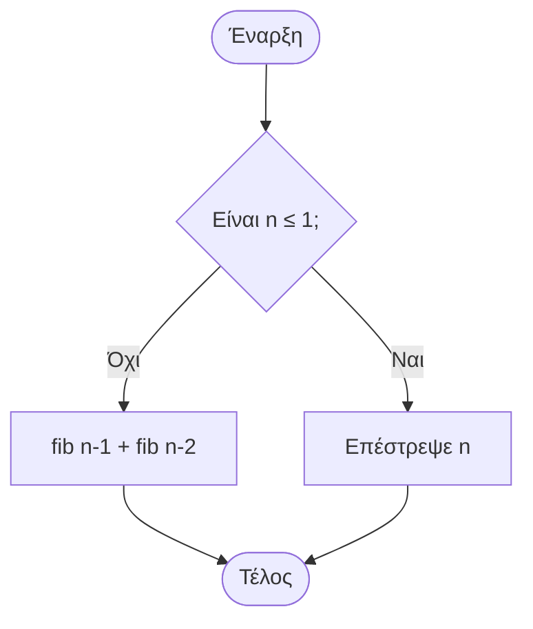
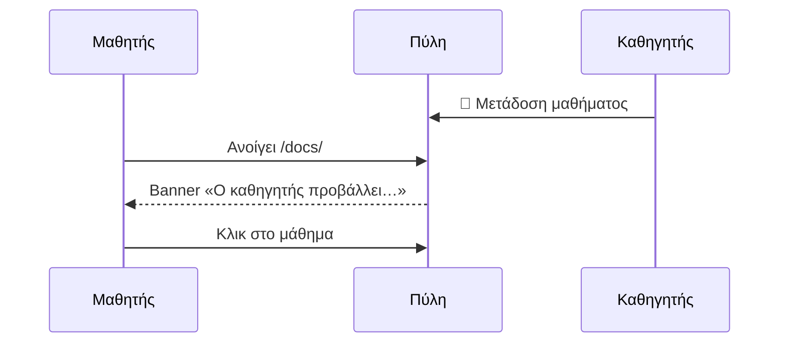
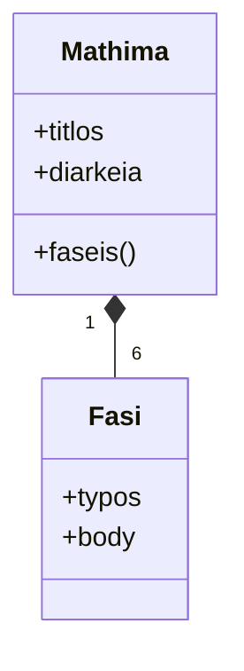
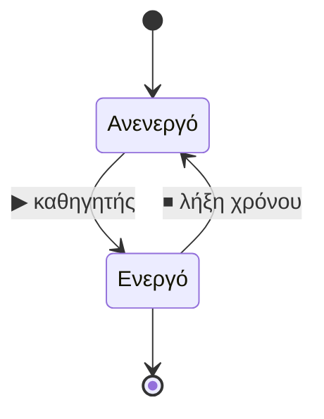
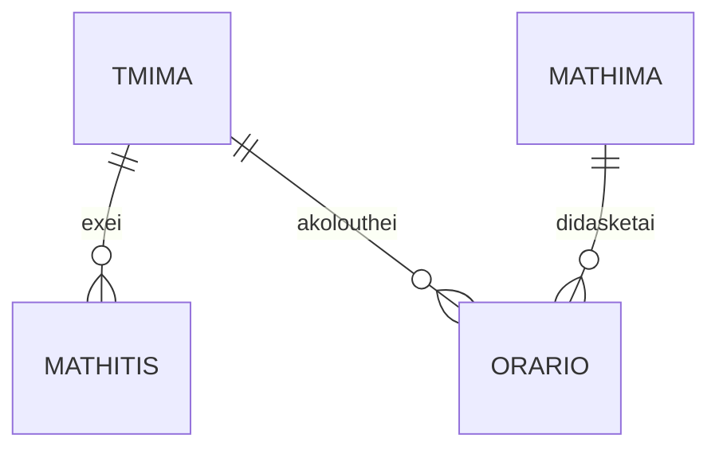
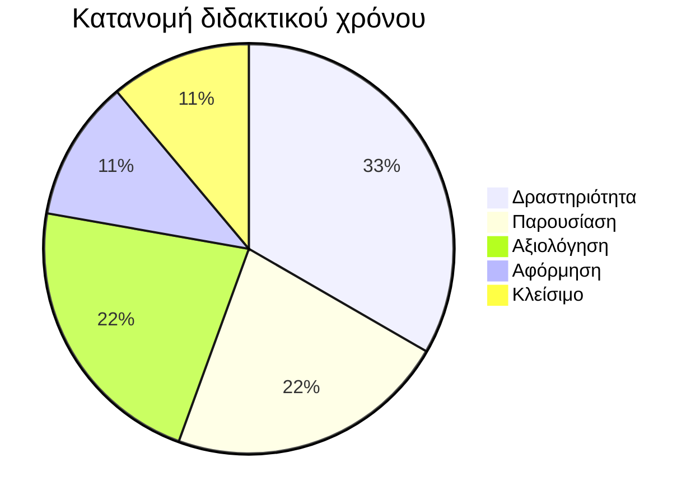
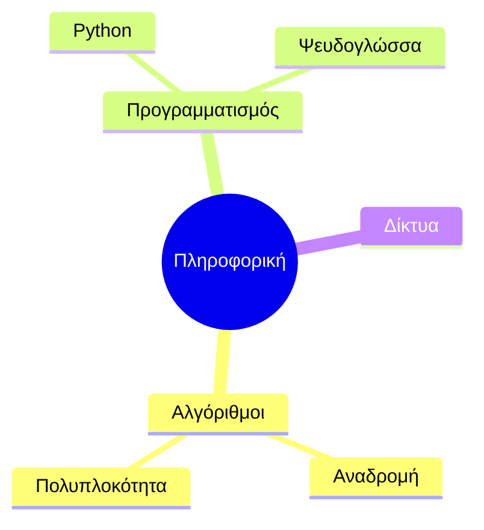
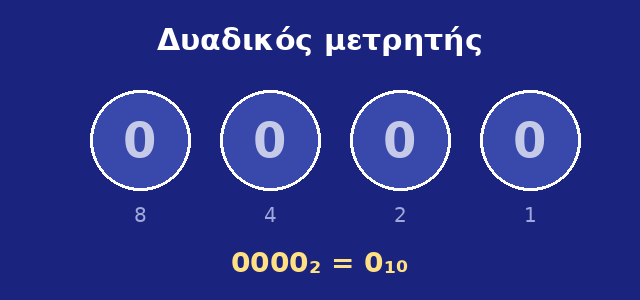

# 🎪 Παράδειγμα ΟΛΩΝ των δυνατοτήτων MkDocs

Αυτή η σελίδα είναι **ζωντανή βιτρίνα** κάθε δυνατότητας του Material for MkDocs
όπως είναι στημένη στην πύλη μας — όλα **100% τοπικά/offline**. Ό,τι δεν υπάρχει
κατεστημένο, επισημαίνεται με 🔧 **«Απαιτεί εγκατάσταση»** και τις ακριβείς εντολές.

[TOC]

---

## 1. Μορφοποίηση κειμένου

**Έντονα**, *πλάγια*, ***έντονα πλάγια***, ==μαρκαρισμένα==, ^^υπογραμμισμένα^^,
~~διαγραμμένα~~, `inline κώδικας`, H~2~O, x^2^, ++ctrl+c++ (πλήκτρα).

Σύνδεσμος με ιδιότητες: [Άνοιγμα πίνακα σε νέα καρτέλα](/board/){target=_blank} ·
[Κουμπί-σύνδεσμος](/lesson-wizard/){.md-button .md-button--primary}

*[HTML]: HyperText Markup Language
Η HTML είναι γλώσσα σήμανσης — το abbr εμφανίζει ορισμό στο hover.

Ορισμοί:

Λέξη-κλειδί
:   Η εξήγησή της (definition list).

Υποσημειώσεις[^1] λειτουργούν παντού.

[^1]: Αυτή είναι υποσημείωση — εμφανίζεται αυτόματα στο τέλος της σελίδας.

Emoji: :material-school: :fontawesome-brands-python: :octicons-rocket-24: 🚀

## 2. Admonitions (πλαίσια ειδοποιήσεων)

!!! note "Σημείωση"
    Κανονικό πλαίσιο σημείωσης με **markdown** μέσα.

!!! abstract "Περίληψη"
    Σύνοψη μαθήματος.

!!! info "Πληροφορία"
    Χρήσιμη πληροφορία.

!!! tip "Συμβουλή"
    Μπορείς να κάνεις κλικ στους τίτλους για αναδίπλωση με `???`.

!!! success "Επιτυχία"
    Μπράβο!

!!! question "Ερώτηση"
    Τι θα συμβεί αν…;

!!! warning "Προσοχή"
    Πρόσεχε τα άκρα των πινάκων.

!!! failure "Αποτυχία"
    Κάτι πήγε στραβά.

!!! danger "Κίνδυνος"
    Μη διαγράψεις το `/var/www/docs`!

!!! bug "Σφάλμα"
    Αναφορά bug.

!!! example "Παράδειγμα"
    Παράδειγμα χρήσης.

!!! quote "Ρήση"
    «Η φαντασία είναι πιο σημαντική από τη γνώση.» — Α. Αϊνστάιν

??? note "Αναδιπλούμενο πλαίσιο (κλικ για άνοιγμα)"
    Κρυμμένο περιεχόμενο — ιδανικό για λύσεις ασκήσεων.

???+ tip "Ανοιχτό αναδιπλούμενο πλαίσιο"
    Ξεκινά ανοιχτό, αλλά κλείνει.

## 3. Καρτέλες (tabs)

=== "Python"

    ```python
    print("Γεια κόσμε!")
    ```

=== "Ψευδογλώσσα"

    ```glossa
    Αλγόριθμος Γεια
      Γράψε "Γεια κόσμε!"
    Τέλος Γεια
    ```

=== "JavaScript"

    ```javascript
    console.log("Γεια κόσμε!");
    ```

## 4. Πίνακες & λίστες εργασιών

| Δυνατότητα | Κατάσταση | Σημείωση |
|:-----------|:---------:|---------:|
| Μαθηματικά | ✅ | MathJax τοπικά |
| Διαγράμματα | ✅ | Mermaid τοπικά |
| Slides | ✅ | Reveal.js τοπικά |
| Marp CLI | 🔧 | απαιτεί εγκατάσταση |

- [x] Έτοιμη εργασία
- [ ] Εκκρεμής εργασία
    - [ ] Υπο-εργασία

1. Αριθμημένη λίστα
2. Δεύτερο στοιχείο
    1. Εμφωλευμένο

## 5. Κώδικας με επισήμανση, αριθμούς γραμμών & annotations

```python title="fibonacci.py" linenums="1" hl_lines="4 5"
def fib(n):
    """Αναδρομικός υπολογισμός Fibonacci."""
    if n <= 1:
        return n            # (1)!
    return fib(n - 1) + fib(n - 2)  # (2)!
```

1. Βάση αναδρομής — χωρίς αυτή δεν σταματά ποτέ!
2. Αναδρομική κλήση: το ίδιο πρόβλημα σε μικρότερη είσοδο.

Inline επισήμανση: `#!python range(10)` μέσα σε πρόταση.

### 🐍 Ζωντανή εκτέλεση Python (Pyodide — πατά ▶ Εκτέλεση)

```python
for i in range(5):
    print("Τετράγωνο του", i, "=", i * i)
```

### Ελληνική ψευδογλώσσα (χρωματισμός στον browser)

```glossa
Αλγόριθμος Άθροισμα
  Διάβασε α, β
  γ ← α + β
  Γράψε γ
Τέλος Άθροισμα
```
## 6. ➗ Μαθηματικά (LaTeX → MathJax, τοπικά)

Inline: ο κύκλος έχει εμβαδόν $A = \pi r^2$ και ο πυθαγόρειος νόμος δίνει $c = \sqrt{a^2+b^2}$.

Block:

$$
\sum_{k=1}^{n} k = \frac{n(n+1)}{2}
$$

Πίνακες, κλάσματα, ολοκληρώματα:

$$
\mathbf{A} = \begin{pmatrix} 1 & 2 \\ 3 & 4 \end{pmatrix},
\qquad
\int_0^\infty e^{-x^2}\,dx = \frac{\sqrt{\pi}}{2},
\qquad
\lim_{n \to \infty} \left(1+\frac{1}{n}\right)^n = e
$$

Χημεία: $\ce{2H2 + O2 -> 2H2O}$ (mhchem μέσω MathJax full).

## 7. 📊 Διαγράμματα Mermaid (τοπικά, light/dark sync)

### Flowchart



### Sequence diagram



### Class diagram



### State diagram



### ER diagram



### Gantt & Pie & Mindmap

```mermaid
gantt
    title Διδακτική ώρα 45΄
    dateFormat mm
    axisFormat %M
    section Φάσεις
    Αφόρμηση        :a1, 00, 5m
    Παρουσίαση      :a2, after a1, 10m
    Δραστηριότητα   :a3, after a2, 15m
    Αξιολόγηση      :a4, after a3, 10m
    Κλείσιμο        :a5, after a4, 5m
```







### 🔧 Διαγράμματα που ΑΠΑΙΤΟΥΝ εγκατάσταση

!!! warning "PlantUML / Graphviz — δεν είναι κατεστημένα"
    Για διαγράμματα **PlantUML** χρειάζεται Java + plantuml.jar και το plugin
    `plantuml-markdown`:

    ```bash
    sudo apt install -y default-jre graphviz
    /opt/school-portal/venv/bin/pip install plantuml-markdown
    # και προσθήκη 'plantuml_markdown' στα markdown_extensions του mkdocs.yml
    ```

    Εναλλακτικά, τα περισσότερα διαγράμματα καλύπτονται ήδη από το **Mermaid** (πάνω).
## 8. 🎞 Παρουσίαση διαφανειών (slides)

### Α. Ενσωματωμένα slides με Reveal.js (τοπικά — πατά το κουμπί)

<div class="slides-source" data-title="🎞 Demo Slides — Αναδρομή" markdown="1">
# Αναδρομή 🌀
Όταν μια συνάρτηση καλεί τον εαυτό της

---

## Τι χρειάζεται;
- **Βάση**: πότε σταματάμε
- **Αναδρομικό βήμα**: μικρότερο πρόβλημα

---

## Παράδειγμα
`fib(n) = fib(n-1) + fib(n-2)`

- fib(0) = 0, fib(1) = 1
- fib(6) = 8

---

# Ευχαριστώ! 🎓
Ερωτήσεις;
</div>

### Β. Fullscreen παρουσίαση φάσεων μαθήματος

Κάθε ημερήσιο μάθημα έχει κουμπί **«🖥️ Παρουσίαση»** (μόνο καθηγητής) που κάνει
fullscreen τις διδακτικές φάσεις με πλοήγηση βελάκια — δες π.χ.
[Μ02 · Πύργοι του Ανόι](../mathimata/gymnasio-g/pliroforiki/m02-pyrgoi-anoy/).

### Γ. PDF διαφάνειες

Ο wizard παράγει `slides.pdf` ανά μάθημα (WeasyPrint) και μπαίνει με embed:
`<object data="slides.pdf" …>` — δες τα υπάρχοντα μαθήματα.

!!! warning "🔧 Marp (marp-cli) — δεν είναι κατεστημένο"
    Το **Marp** μετατρέπει markdown σε PDF/PPTX slides, αλλά θέλει Node CLI:

    ```bash
    sudo npm install -g @marp-team/marp-cli
    marp slides.md -o slides.pdf   # ή --pptx
    ```

    Μέχρι τότε, η ισοδύναμη δυνατότητα καλύπτεται από το **Reveal.js** (πάνω, offline)
    και το WeasyPrint PDF του wizard.

## 9. 🎬 GIF Animation & πολυμέσα

{width="480"}

*Το GIF παράγεται με Pillow από το `scripts/make-demo-assets.py` — καμία εξωτερική υπηρεσία.*

Video (mp4/webm) μπαίνει με απλό HTML `<video controls>` — οι τύποι επιτρέπονται στο upload.

!!! warning "🔧 Αυτόματη μετατροπή video (ffmpeg) — δεν είναι κατεστημένο"
    Για συμπίεση/μετατροπή ανεβασμένων video σε web mp4:

    ```bash
    sudo apt install -y ffmpeg
    ffmpeg -i input.mov -c:v libx264 -crf 23 -c:a aac output.mp4
    ```

## 10. 🖼 Εικόνες — zoom (glightbox), λεζάντες

{width="240" loading=lazy}

Κλικ σε οποιαδήποτε εικόνα → μεγέθυνση με **glightbox** (ήδη εγκατεστημένο plugin).

## 11. ❓ Διαδραστικό κουίζ (quiz.js)

<div class="quiz" data-quiz='[
 {"q":"Πόσα bits χρειάζονται για τον αριθμό 15;","options":["3","4","8"],"answer":1,"explain":"15 = 1111₂ → 4 bits."},
 {"q":"Τι τυπώνει η print(2**3);","options":["6","8","9"],"answer":1,"explain":"2**3 = 8 (δύναμη)."}
]'></div>

## 12. 🎮 Ενσωμάτωση εφαρμογών & προσομοιώσεων (iframe)

Οι custom εφαρμογές της πύλης μπαίνουν με iframe:

<iframe src="/apps/binary-converter/" width="100%" height="420" style="border:1px solid #c5cae9;border-radius:8px;" loading="lazy" title="Μετατροπέας Δυαδικού"></iframe>

Σύνδεσμοι προς εργαστήρια: [CircuitJS](/circuits/){target=_blank} ·
[Blockly](/blockly/){target=_blank} · [SQL Playground](/sql/){target=_blank} ·
[Web Lab](/web-lab/){target=_blank} · [H5P Studio](/h5p-studio/){target=_blank}

## 13. 📖 Βιβλιοθήκη & links σε συγκεκριμένη σελίδα PDF

Τα βιβλία μπαίνουν από το **Lesson Wizard → 📖 Βιβλία** και ζουν στο
[/docs/vivliothiki/](../vivliothiki/). Link σε συγκεκριμένη σελίδα:

```markdown
[📖 Βιβλίο Πληροφορικής, σελ. 10](/docs/vivliothiki/vivlio.pdf#page=10){target=_blank}
```

!!! info "Γιατί `#page=10` και όχι `#pagenumber=10`;"
    Το `#page=N` είναι το **πρότυπο Adobe PDF Open Parameters** που αναγνωρίζουν
    όλοι οι ενσωματωμένοι PDF viewers (Chrome/Firefox/Edge). Το `#pagenumber=`
    δεν αναγνωρίζεται από κανέναν browser. Υποστηρίζονται επίσης
    `#page=10&zoom=150` και `#nameddest=…`.

## 14. Snippets (επαναχρησιμοποίηση περιεχομένου)

Το `pymdownx.snippets` είναι ενεργό — μπορείς να ενσωματώσεις άλλο αρχείο:

```markdown
--8<-- "paradeigma-dynatotiton/snippet-demo.md"
```

Αποτέλεσμα:

--8<-- "paradeigma-dynatotiton/snippet-demo.md"

## 15. 🔧 Συγκεντρωτικός πίνακας «τι λείπει»

| Δυνατότητα | Κατάσταση | Εγκατάσταση |
|---|---|---|
| MathJax, Mermaid, Reveal.js | ✅ τοπικά | `install.sh` (vendor assets) |
| Pyodide Python | ✅ τοπικά | ήδη εγκατεστημένο |
| PlantUML | 🔧 λείπει | `apt install default-jre graphviz` + `pip install plantuml-markdown` |
| Marp CLI slides | 🔧 λείπει | `npm install -g @marp-team/marp-cli` |
| ffmpeg video | 🔧 λείπει | `apt install ffmpeg` |
| LaTeX→PDF export βιβλίου | 🔧 λείπει | `apt install texlive-xetex` (το pandoc-app κάνει ήδη PDF μέσω WeasyPrint ✅) |